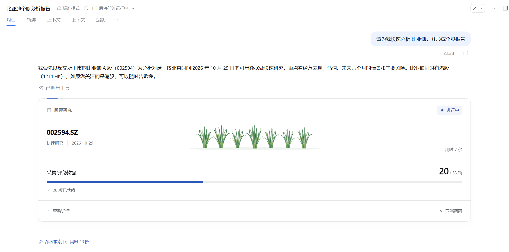
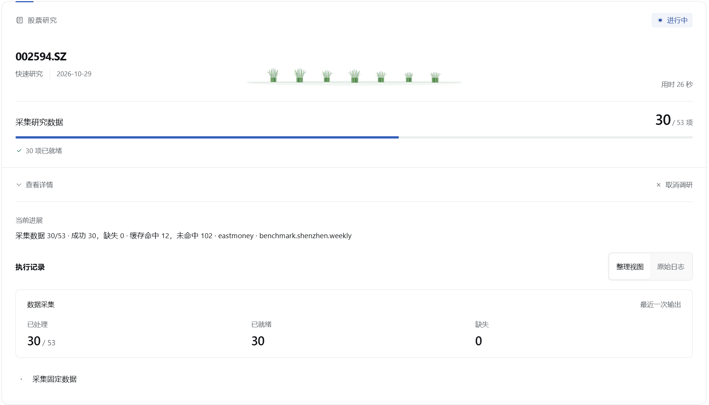
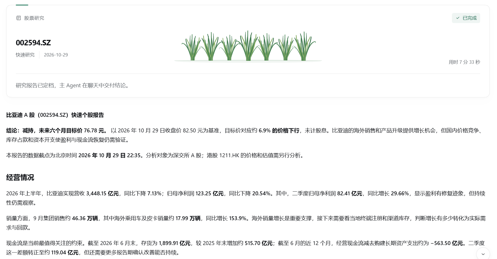
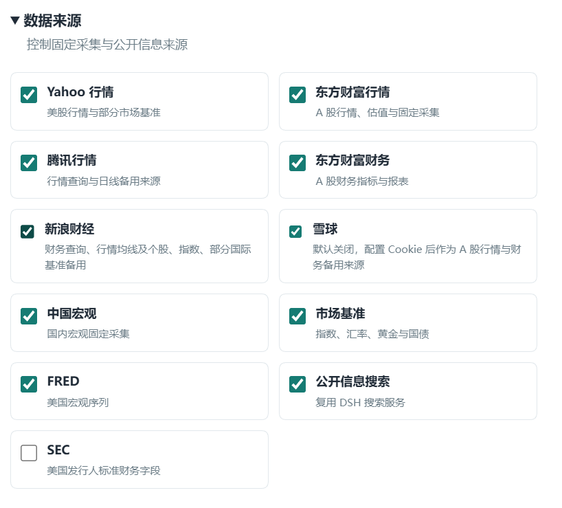

# DSH Stock Research

**面向 A 股与美股的单股研究插件，为研究过程保留数据、证据与分析产物。**

基于 [deepseek-harness](https://github.com/deepseek-ai/deepseek-harness)（DSH）构建，支持从固定数据快照出发进行问答、快速研究、深度研究和复盘。研究由主 Agent 协调多个研究角色完成；插件不执行交易。

[开发理念](#开发理念) · [功能](#功能) · [开始使用](#开始使用) · [研究过程](#研究过程) · [配置](#配置) · [数据来源](#数据来源) · [故障排查](#故障排查) · [本地开发](#本地开发)

## 开发理念

**用确定性约束不确定性，在不确定性中寻找确定性。**

数据采集、快照保存和估值计算采用明确的流程与口径，记录来源、输入和计算结果，为模型分析提供可查阅的依据。研究过程保留不同角色的分析、讨论与风险评估，通过分阶段验收组织模型的判断。

市场变化和未来经营始终存在不确定性。项目通过分析公开数据、估值依据、预期差与催化剂，寻找有证据支持的判断，同时呈现数据缺口与风险，供后续复盘和重新检视。

## 功能

- **个股问答**：基于采集到的数据快照回答具体问题。
- **快速与深度研究**：主 Agent 组织分析、多空讨论和风险评估，分阶段验收并汇总报告。
- **复盘与重跑**：基于既有研究记录复盘，或使用固定输入创建派生运行。
- **保留研究依据**：保存数据快照、证据、产物和采集诊断，方便后续查阅。

| 研究方式 | 分析范围                                                             | 后续流程                                                 |
| -------- | -------------------------------------------------------------------- | -------------------------------------------------------- |
| 快速研究 | 市场、基本面、宏观、公开信息                                         | 一轮多空讨论，综合风险分析                               |
| 深度研究 | 市场、基本面、宏观、公开信息，并增加经营、地缘政治和交易行为与参与度 | 两轮多空讨论，制定研究计划，分别评估财务、估值和事件风险 |

快速研究适合形成初步判断；深度研究适合进一步检验判断，通常需要更多时间和模型调用。

在聊天中提出需求后，任务卡显示研究进度：



## 开始使用

### 安装

需要 Node.js **24.16.0**、DSH **0.2.1 系列（从 0.2.1-rc.1 起）** 和 pnpm。使用前请在 DSH 中配置模型与凭证。将插件安装到使用的 profile（以 `web` 为例）：

```bash
dsh plugin --profile web add @megapandas/dsh-stock-research@next
```

npm 发布版本可能落后于 GitHub 仓库；如需最新代码，请从源码构建，参见[本地开发](#本地开发)。

安装后启动对应的 DSH profile；已运行的实例未自动加载插件时，重启后再使用。自定义 profile 需提供 Agent、工具、模型、命令及本地子 Agent 等基础服务。

### 发起研究

在 DSH 聊天中直接提出研究需求，例如：

```text
请对 002594.SZ 比亚迪做一次快速个股调研。
请对 NASDAQ:NVDA 做一次深度调研，研究日期为 2026-10-23。
```

默认使用 DSH 数据目录，研究子 Agent 继承当前会话的模型设置。

标的需要明确交易所：A 股可使用 `002594.SZ` 或 `CN:002594.SZ` 等形式，美股使用 `NASDAQ:NVDA` 或 `NYSE:IBM` 等形式。研究日期使用 `YYYY-MM-DD` 格式。

### 常用命令

日常使用可直接与主 Agent 对话。需要明确指定操作时，也可以使用以下命令；涉及既有研究的操作使用对应的 `runId`。

| 命令                           | 用途                                   |
| ------------------------------ | -------------------------------------- |
| `/stock-ask`                   | 基于采集快照回答问题                   |
| `/stock-quick` / `/stock-deep` | 发起快速或深度研究                     |
| `/stock-status`                | 查看研究状态、任务和阻塞原因           |
| `/stock-resume`                | 解决阻塞原因后继续研究                 |
| `/stock-redo`                  | 重做指定任务，并使受影响的下游结果失效 |
| `/stock-cancel`                | 取消研究                               |
| `/stock-recover`               | 确认宿主中断遗留的运行中尝试已经停止   |
| `/stock-review`                | 基于既有研究保存独立复盘记忆           |
| `/stock-replay`                | 使用固定输入创建派生运行               |

`/stock-gc all` 清除缓存、研究运行、草稿和复盘数据，保留 `collections/` 中的独立采集快照与诊断。任务运行时不可执行清理；清除后的研究记录无法再用于复盘或重跑。

## 研究过程

### 数据采集与报告

1. **采集数据**：问答和研究先执行固定采集流程，取得必需日线后采集其余数据，保存快照和诊断。
2. **分析与交接**：研究子 Agent 使用固定输入分章节撰写报告，提交正文及结构化交接。
3. **验收与汇总**：主 Agent 可以追问、要求修改，验收后推进讨论、风险评估和决策，最终交付报告。

采集结果和诊断保存在数据目录的 `collections/<UUID>.json` 中，正式研究另行保存其使用的固定输入。公开信息搜索由研究角色按需执行，额度耗尽后需要审批；搜索多次被拒时暂停，由用户或主 Agent 判断是否恢复。

每张表按已启用的来源及缓存选择结果；来源失败或核心数据不完整时尝试备用。采集受每表时间预算约束，可重试的网络错误最多尝试两轮。结果按整表采用，记录实际来源和缺口，不跨来源拼接数值；没有可用备用源时保留缺口。

展开任务卡可以查看采集进度和执行记录：



研究完成后，主 Agent 在聊天中交付报告。下图为一次快速研究的报告示例，结论仅反映当次研究：



### 财务分析与估值

财务快照包含派生指标及其计算口径，包括 TTM、单季度、同比、利润率和历史倍数统计。研究使用估值引擎，根据业务和数据选择模型并提供预测依据；计算输入、步骤、算法版本和结果随研究保存，报告通过计算编号引用结果。

研究区分研究日内在价值与目标日市场定价，并结合预期差及催化剂解释预测与估值。折现模型按实际天数计算，剔除价值日期之前的现金流；负股权残值保留为偿付分析的依据。

## 配置

在 DSH Web 界面打开 **设置 → 股票研究**，可按需调整以下选项：

| 选项               | 用途与默认行为                                                                                                                                                     |
| ------------------ | ------------------------------------------------------------------------------------------------------------------------------------------------------------------ |
| 研究模型与思考强度 | 配置研究子 Agent 使用的模型；默认继承主 Agent 的会话设置。主 Agent 始终使用当前会话模型。                                                                          |
| 免审批搜索次数     | 每次公开信息研究尝试默认可搜索 8 次，超过后每次搜索需要审批；设为 0 时每次都需要审批。搜索后端由 DSH 配置。                                                        |
| 数据来源           | 控制行情、财务、宏观、基准和公开信息来源。雪球默认关闭，启用时须填写 Cookie；SEC 默认关闭，启用时须提供请求身份、有效联系方式以及已确认的股票 ID 与十位 CIK 映射。 |
| 数据目录           | 保存缓存、采集快照、研究记录和复盘记忆，通常为 `~/.dsh/stock-research`，随 DSH 数据目录变化。切换目录不会迁移原有数据。                                            |
| 网络与缓存         | 调整请求超时、最大并发、最小间隔、缓存容量及各类数据的缓存有效期。缓存过期不删除已保存的研究记录。                                                                 |
| 数据新鲜度         | 设置行情、财务和宏观数据的新鲜度阈值；超过阈值的数据会标记为陈旧。                                                                                                 |

修改后需保存。模型与搜索额度对新任务生效，在途研究保留启动时的设置；数据目录、来源、网络与缓存等资源配置需在研究空闲时保存，并在下一次研究操作前应用。

## 数据来源

插件通过以下来源获取数据；雪球和 SEC 默认关闭，其余来源在默认配置中启用。公开信息搜索还需要在 DSH 中配置搜索后端。实际采集内容取决于市场、来源设置及数据可用性。



图中展示的是一组配置示例，雪球已手动启用。

| 数据           | 来源与用途                                                                                                                                                                     |
| -------------- | ------------------------------------------------------------------------------------------------------------------------------------------------------------------------------ |
| 行情与估值     | 东方财富提供 A 股行情和估值；Yahoo Finance 提供美股行情及部分市场基准；腾讯行情和新浪财经提供部分行情查询或备用数据；雪球可作为 A 股行情和四组外汇原生 K 线的备用来源。        |
| 财务           | 东方财富和新浪财经提供 A 股财务数据，雪球可作为固定财务采集的备用来源。美国证券交易委员会（SEC）可提供美股发行人标准财务字段，默认关闭，启用前须配置请求身份、联系方式及 CIK。 |
| 宏观与市场基准 | 东方财富提供中国宏观及部分指数、汇率、黄金和国债数据；商务部数据中心提供社融数据；FRED 提供美国宏观序列；部分市场基准使用 Yahoo Finance。                                      |
| 公开信息       | 通过 DSH 配置的搜索服务获取，具体搜索后端由宿主决定。                                                                                                                          |

美股固定采集目前以日线、有限的 SEC 财务字段和美国宏观序列为主，不包含完整财务比率、估值及周月线；未启用 SEC 时也不会采集其财务数据。

### 雪球备用来源

在 **设置 → 股票研究 → 数据来源** 启用雪球，将已登录雪球 Cookie 中 `xq_a_token`、`u`、`xq_is_login` 的值分别填入三个输入框，无需手动拼接。插件不会自动获取 Cookie，失效后需手动更新。Cookie 随宿主配置保存，请勿放入研究对话或提交到代码仓库。

雪球备用覆盖 A 股日、周、月线、最新报价、财务指标和三张财务明细表，以及 USD/CNY、USD/CNH、EUR/USD、USD/JPY 的原生日、周、月 K 线。个股 K 线在东方财富、腾讯和新浪之后尝试雪球；外汇在主源之后先尝试雪球，再使用其他已配置备用源。雪球不采集讨论、文章或情绪数据。

财务三表从东方财富 F10 明细或雪球明细取得，覆盖债务、营运资本、利润构成和现金流。折旧摊销补充法、租赁负债及使用权资产由 F10 提供；雪球未提供的字段保持为空。财务披露时间及历史修订状态标记为未验证。

## 故障排查

### 数据目录被占用

出现 `Cannot acquire data-root writer lock` 时，检查是否有其他 DSH 实例使用同一数据目录。写权限由 SQLite 单写者事务管理，进程退出（包括强制退出）后自动释放；`.writer.lock` 文件保留，不需要删除。

### 研究中断

重新启动 DSH 不会自动恢复中断的研究。先查看研究状态，再让主 Agent 确认遗留尝试已经停止、处理阻塞原因并继续；相关操作对应 `/stock-recover` 和 `/stock-resume`。

### 运行版本不可用

角色派工、恢复和重跑只支持当前角色协议，不提供旧协议执行兼容。遇到 `VERSION_UNAVAILABLE` 时应新建研究；已保存的历史报告和计算记录仍可读取。无法重现旧估值算法的运行同样需要新建研究。

## 本地开发

在项目目录安装依赖并执行构建和检查：

```bash
npm ci
npm run build
npm run typecheck
npm test
npm run lint
npm run format:check
npm run test:package
```

`test:package` 检查构建产物与包入口。需要验证真实宿主装配时，构建后运行 `npm run test:runtime-package` 和 `npm run test:application-package`；角色准备性能可用 `npm run bench:roles` 测量，该基准不调用模型或数据源。

`npm run test:install` 将构建产物打包，在临时目录安装开发依赖锁定的 DSH 版本并启动独立宿主，验证安装、插件装配、工具和设置；该检查不读取用户 profile、凭证或研究数据，也不调用模型。可用 `npm run test:install -- --dsh-version 0.2.1-rc.5` 指定另一个受支持的精确版本。

从源码安装时，运行 `npm pack` 生成包含构建产物的归档，再安装到目标 profile：

```bash
npm pack
dsh plugin --profile web add "/绝对路径/megapandas-dsh-stock-research-<版本>.tgz"
```

将示例路径替换为 `npm pack` 输出的归档路径。`npm pack` 会通过 `prepack` 自动构建。

### 单独采集数据

以下脚本仅支持显式指定的沪深 A 股代码，使用脚本内的来源配置采集数据，不读取 DSH 界面设置，也不调用模型。先完成构建，再运行：

```bash
npm run collect:data -- SH.600519 2026-10-27 /tmp/stock-collection
```

输出目录须不存在。结果包含快照、汇总、逐表数据、请求记录和原始响应；来源失败及覆盖不足分别保存在失败清单和缺口中。

## 参考与致谢

项目基于 [deepseek-harness](https://github.com/deepseek-ai/deepseek-harness) 开发，研究思路参考了 [TradingAgents](https://github.com/TauricResearch/TradingAgents)。

## 免责声明

本项目仅供研究和学习使用，生成的内容不构成投资建议或交易依据。

## 许可证

[MIT](LICENSE)
